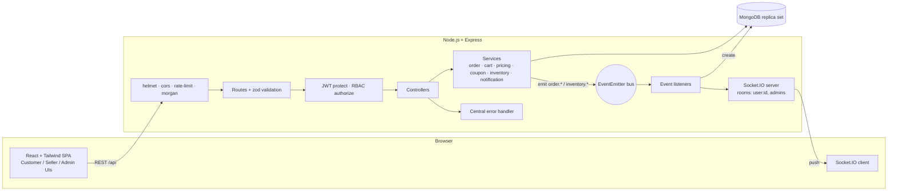

# Architecture



## ASCII overview
```
 React SPA ──HTTP──▶ Express ─▶ routes ─▶ validate(zod) ─▶ protect/authorize ─▶ controller ─▶ service ─▶ Mongoose ─▶ MongoDB
     ▲                                                                              │
     └────────Socket.IO◀── listeners ◀── EventEmitter ◀────────── domain events ◀────┘
```

## Layers (MVC + services)
- **models/** – Mongoose schemas, validation, indexes.
- **controllers/** – HTTP concerns only (parse, authorise ownership, shape response).
- **services/** – business rules: pricing, coupon validation, atomic stock reservation, order lifecycle, notification fan-out.
- **middleware/** – auth, RBAC, validation, error handling.
- **sockets/** + **services/listeners.js** – event-driven real-time delivery.

## Checkout sequence
1. Load cart → merge lines → read products.
2. For each line: atomic `findOneAndUpdate` (stock ≥ qty, price unchanged) → reserve stock.
3. Validate coupon → atomic usage increment.
4. Server-side totals → create order with snapshots → clear cart.
5. Commit (transaction) *or* on failure abort / run compensating undo actions.
6. Emit `order.placed`, `inventory.changed` → listeners create notifications (seller new-order, low-stock) and push sockets.
